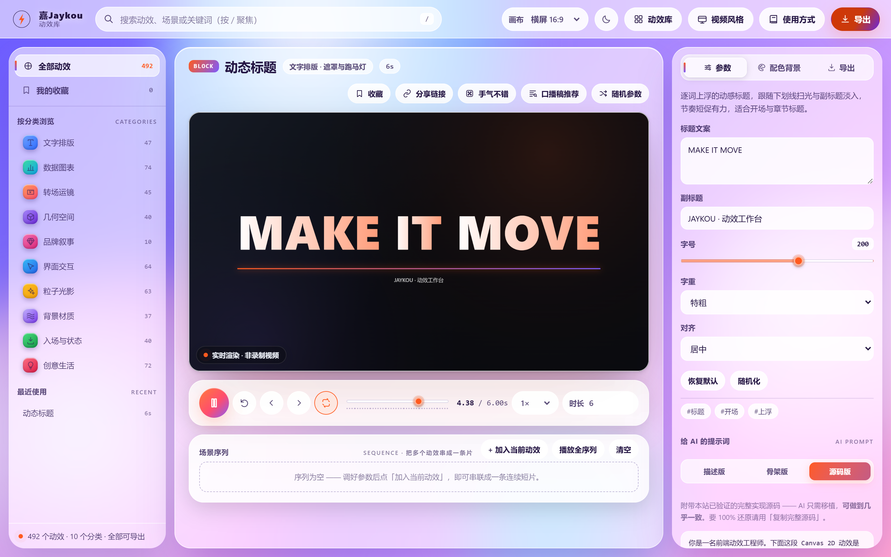
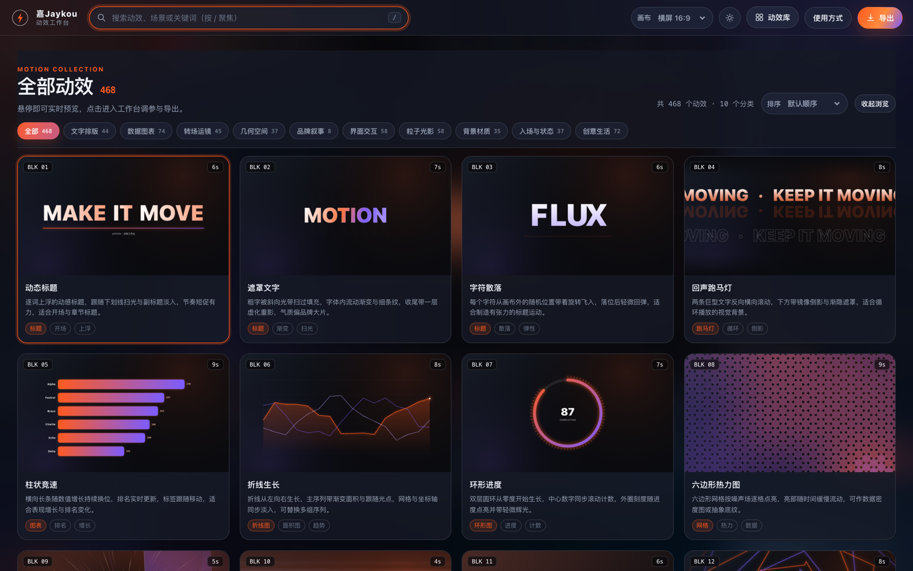
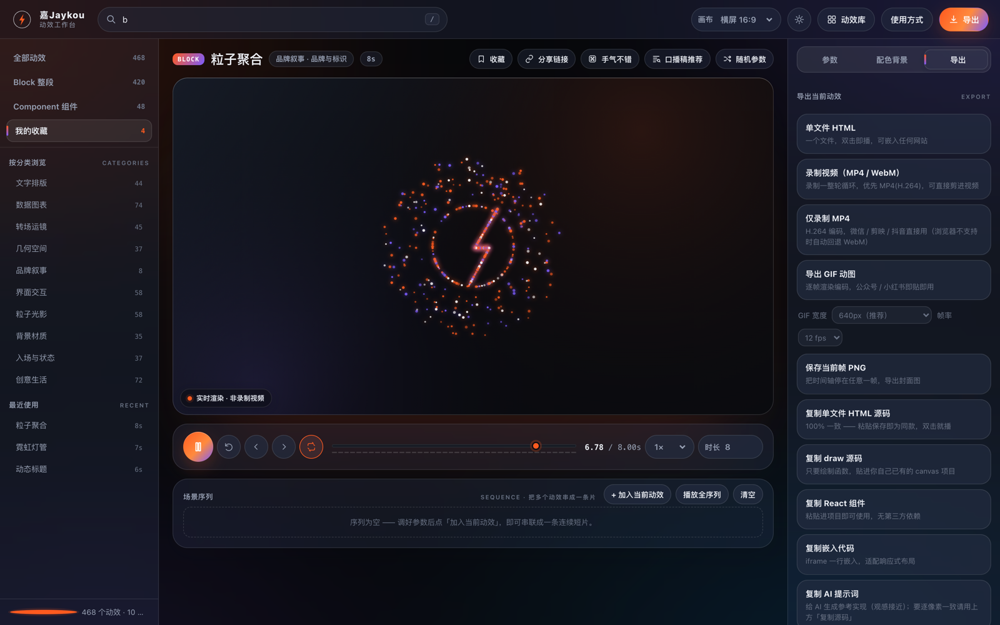
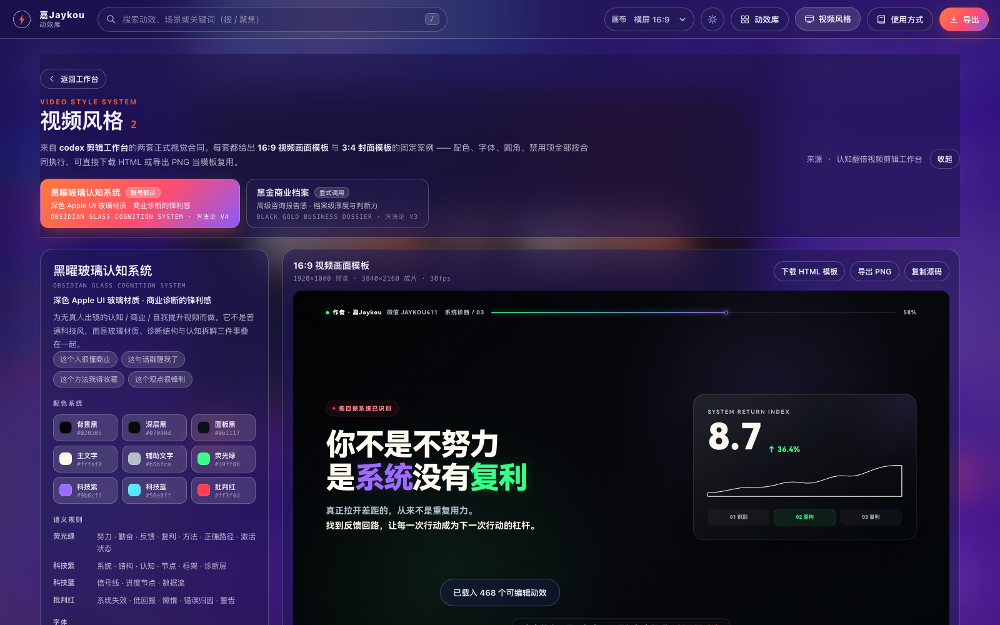
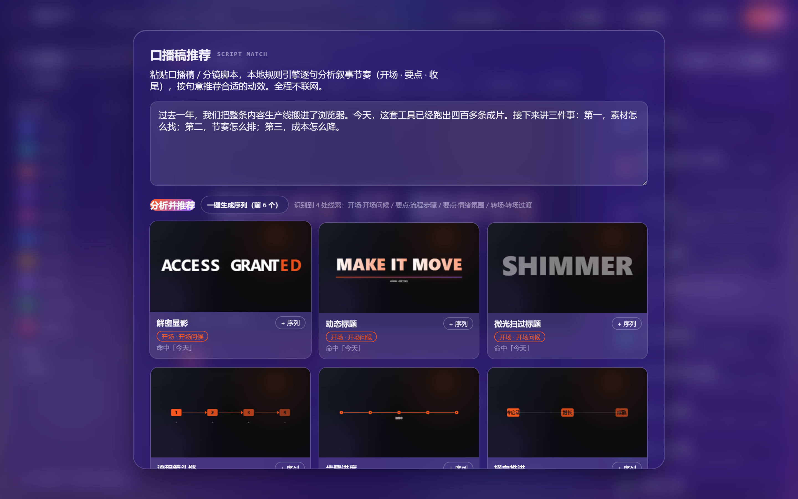

# 嘉Jaykou动效库 · MOTIONFORGE

浏览器里的动效工作台：468 个可调可导出的 Canvas 动效，全部纯静态（无构建依赖，打开 `index.html` 即用）。

## 界面一览

<picture>
  <source media="(prefers-color-scheme: dark)" srcset="screenshots/hero-dark.png">
  
</picture>

| 素材库 · 468 个缩略图悬停即预览 | 导出 · GIF / MP4 / HTML / React 一站式 |
| --- | --- |
|  |  |
| **视频风格** · codex 剪辑工作台两套视觉合同 + 固定案例模板 | **口播稿推荐** · 粘贴文案按叙事节奏推荐动效 |
|  |  |

## 功能

- **468 个动效** / 10 大类：转场、文字、图表、粒子、几何、物理、UI、装饰、手绘、扫描巡检
- **视频风格**：来自 codex 剪辑工作台的两套正式视觉合同 —— **黑曜玻璃认知系统**（方法论 V4 · 默认）与**黑金商业档案**（方法论 V3 · 显式调用）。每套含 16:9 视频画面模板（1920×1080）与 3:4 封面模板（1536×2048）的固定案例，配色 / 字体 / 语义 / 硬规则 / 禁用项全部按合同录入，可下载 HTML 模板或导出 PNG 直接复用（快捷键 V）
- **实时调参**：时长、色彩预设、逐参数滑块，改动立刻在舞台上生效
- **导出**：GIF / MP4 / 单文件 HTML / React 组件 / 序列 JSON
- **收藏夹**：收藏喜欢的动效，一键导出为自包含 HTML 收藏集（深色 / 浅色双版式）
- **口播稿推荐**：粘贴一段文案，按叙事节奏（开场 / 要点 / 收尾）推荐适配动效，一键生成序列
- **手气不错**：随机动效 + 随机参数 + 随机配色
- **其他**：深链分享（`#e=<动效id>`）、快捷键、PWA 离线可用、`prefers-reduced-motion` 降级

## 使用

直接双击 `index.html`，或起一个静态服务：

```bash
python3 -m http.server 8899
```

然后打开 <http://127.0.0.1:8899/>。

## 目录

```
嘉Jaykou动效库.html   品牌同名入口（构建脚本自动生成，与 index.html 同步，勿直接编辑）
index.html            工作台主页面（GitHub Pages 根入口，不可改名）
guide.html            使用指南 + 版本 changelog
assets/css/app.css    全部样式
assets/js/effects-*.js  动效库（按批次拆分，24 个文件）
assets/js/engine.js   运行时内核（MF.* API、渲染循环、导出）
assets/js/styles-kit.js  视频风格系统（两套视觉合同 + 固定案例模板 + HTML/PNG 导出）
assets/js/studio.js   工作台 UI 逻辑
assets/js/bundle.js   以上脚本的合并产物（页面实际加载的就是它）
assets/js/vendor/     gifenc.js（GIF 编码）
sw.js                 Service Worker：页面网络优先 + 静态资源后台静默更新
tools/build-bundle.py 把 31 个 JS 合并成 bundle.js，并同步生成品牌同名入口
```

改完 `assets/js/*.js` 后需要重新打包：

```bash
python3 tools/build-bundle.py
```

## 技术说明

- 渲染全用原生 Canvas 2D，无第三方动效库
- 确定性随机：mulberry32 种子，同一参数每次渲染一致
- 缩放基准：所有参数按 1080p 设计，运行时按 `min(W/1920, H/1080)` 自适应

---

品牌：嘉Jaykou · MOTIONFORGE
